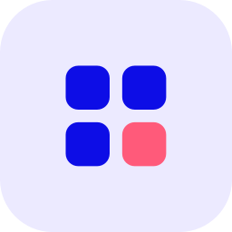

  
  <h1>@upfluence/oss-components</h1>
  
This addon hosts branded components, following the OSS framework, for use in our projects.

[Compatibility](#compatibility) •
[Installation](#installation) •
[Running / Development](#running--development) •
[Adding it to a project](#adding-it-to-a-project)

## Compatibility

- Ember.js v6.12 or above
- Node.js v24 or above
- pnpm 10

Required peer dependency: `ember-source` `^6.12.0`.

Apps on Ember.js below 6.12 should stay on `3.x`.

## Installation

As any NPM package, you can install it via:
`pnpm add @upfluence/oss-components`

## Running / Development

This addon's dummy app is actually a showcase of the frontend framework
and its custom components.

It's an Ember app, so we assume you have all set up as that's our
frontend stack anyway.

- `make install`
- `pnpm start`
- Visit your app at [http://localhost:4200](http://localhost:4200).

## Adding it to a project

### Asset-map adapter

OSS now provides an asset-map adapter through its top-level app re-exports and an explicitly imported final-build-tree wrapper. See [Consumer-owned asset maps](docs/asset-map.md) for setup and the plugin-web pilot.

This allows the consuming app to build and fingerprint its complete asset output, including assets supplied by addons, and inject the consumer's completed manifest into its HTML. Full compatibility with the existing template helpers and `assetMap.resolve(path)` (previously brought by `ember-cli-ifa`) calls is maintained.
